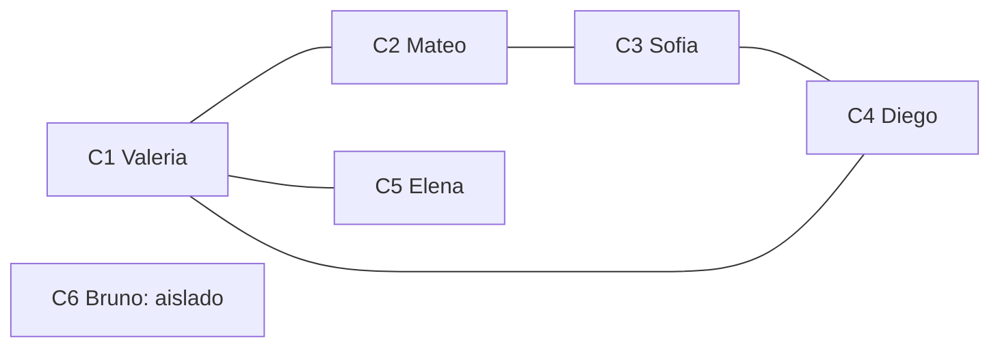

# ConectaCampus | Grafos y vértices

Proyecto educativo Java 17 para KEN3DYY. Modela una red de amistad simple, no dirigida y no ponderada con listas de adyacencia propias. No requiere librerías externas.

## Informe y evidencia

[Descargar informe editable en Word](docs/Informe_ConectaCampus.docx)

Las salidas de ejecución están en [evidencias](evidencias/). GitHub Actions compila y prueba el proyecto en Java 17 y 21.

## Compilar, ejecutar y probar

Desde la raíz del proyecto, con un JDK 17 o superior:

```sh
javac -encoding UTF-8 --release 17 -Xlint:all -d bin src/conectacampus/*.java test/conectacampus/*.java
java -cp bin conectacampus.Main
java -cp bin conectacampus.Main --demo
java -cp bin conectacampus.RedSocialTest
```

En Eclipse: crear un Java Project con JDK 17+, agregar `src` y `test` como carpetas fuente y ejecutar `conectacampus.Main`. Para las pruebas, ejecutar `conectacampus.RedSocialTest`.

## Red del ejemplo

| ID | Usuario | Vecinos | Grado |
|---|---|---|---:|
| C1 | Valeria | C2, C4, C5 | 3 |
| C2 | Mateo | C1, C3 | 2 |
| C3 | Sofia | C2, C4 | 2 |
| C4 | Diego | C1, C3 | 2 |
| C5 | Elena | C1 | 1 |
| C6 | Bruno | Ninguno | 0 |

Hay 6 vértices, 5 amistades y 2 componentes. Ciclo: C1-C2-C3-C4-C1. Densidad: 5/15 = 33,33 %. Suma de grados: 10 = 2 × 5.



## Decisiones y mejoras

- Identidad por ID normalizado con `Locale.ROOT`; nombres repetidos permitidos sin ambigüedad.
- Modelo sin impresiones; interfaz de consola separada.
- BFS para componentes y caminos mínimos; DFS iterativo para reconstruir un ciclo.
- Índices estables: recorridos O(V + E), sin búsquedas lineales de índices dentro de los recorridos.
- Grado almacenado por vértice; la consulta por ID cuesta O(V) por la búsqueda del usuario.
- Matriz O(V² + E); densidad O(1), multiplicación en double para evitar desbordamiento intermedio.
- Vértices almacenados en ArrayList y amistades en nodos enlazados propios. No usa HashMap, HashSet, TreeMap ni TreeSet.
- Devuelve listas inmutables y una matriz nueva. Las aristas se derivan del grafo, sin duplicar su representación en textos.
- EOF termina limpiamente, incluso durante una operación. Locale explícito en cifras; el menú no hace eco artificial de la entrada.
- El informe trabaja sobre la red actual y reporta todos los empates de grado máximo.

## Validaciones y límites

Los extremos deben existir (R1), se rechazan lazos (R2) y amistades duplicadas en cualquier orden (R4), se mantiene reciprocidad (R3), los IDs son únicos (R6) y el nombre no puede estar vacío (R7). Los códigos siguen la referencia consultada; no se inventa una regla R5.

ID: 1 a 20 caracteres ASCII, comienza con letra y permite letras, números, `_` y `-`. Nombre: hasta 60 caracteres, sin controles. Todos los rechazos ocurren antes de mutar el grafo.

El estado vive en memoria. Las opciones 7 y 8 reemplazan la red actual; salir descarta los cambios. No incluye eliminación, persistencia ni concurrencia. La matriz requiere O(V²) memoria, por lo que el informe está pensado para redes pequeñas.

## Pruebas y evidencia

`RedSocialTest` revisa casos vacíos, un solo usuario, altas válidas, homónimos, normalización, rechazos sin mutación, rutas y ciclos. También recorre los 1.024 grafos simples de cinco vértices. Usa Floyd-Warshall como oráculo independiente de distancias y conectividad; valida cada arista de los caminos y ciclos devueltos. Falla mediante AssertionError (no depende de `-ea`).

`evidencias/demo.txt` y `evidencias/pruebas.txt` se generan al ejecutar los programas. El workflow de GitHub verifica Java 17 y 21 cuando se suba el proyecto.

## Referencia y alcance

Diseño escrito para esta entrega a partir de los requisitos estudiados en [Damienq7w/APE4_Fase_1_GrafosyVertices](https://github.com/Damienq7w/APE4_Fase_1_GrafosyVertices), commit `8ff48e01ae77a166d279ed81f59d38688a4409a6`, de Cunalata Mendoza Damian Alexander. Se reconoce la referencia académica; no se reutilizan sus capturas ni se atribuye su autoría a KEN3DYY. Esta implementación tiene otro ejemplo, algoritmos iterativos, resultados estructurados y pruebas independientes. La conformidad con una rúbrica externa requiere revisar esa rúbrica.
